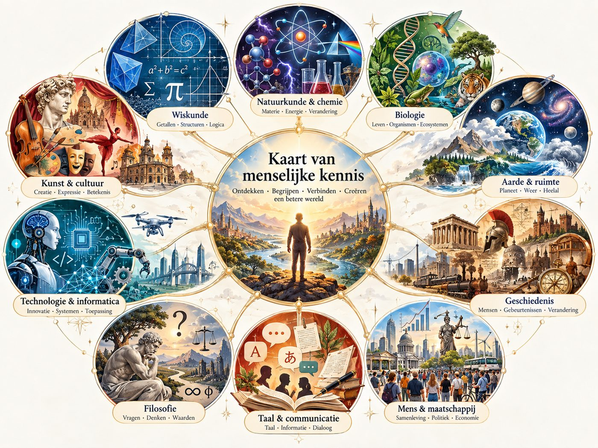

# Kennis door de Eeuwen

Een lokaal draaiende, interactieve leeromgeving voor tien kennisdomeinen, van
wiskunde en natuurkunde tot geschiedenis, filosofie en kunst. Elk domein is een
eigen cursus die van een toegankelijk begin opbouwt tot het niveau van een eerste
studiejaar, met de geschiedenis van het denken als leidraad. Het eerste volledig
uitgewerkte domein is *Rekenen & Wiskunde*; Geschiedenis volgt. Gebouwd volgens
`build_plan.docx`.

**Kern:** begrijpen → toepassen → fouten maken → uitleg krijgen → opnieuw proberen → beheersen.

## Stand van zaken

Elk domein heeft een moduleplan; uitgewerkte modules hebben lessen, oefeningen en een toets.

| Domein | Modules uitgewerkt | Lessen | Oefeningen | Toetsvragen | Tijdlijn | Personen |
|---|---|---|---|---|---|---|
| Wiskunde | 42 van 42 | 330 | 1.746 | 630 | 60 | 23 |
| Geschiedenis | 10 van 23 | 80 | 335 | 150 | 104 | 64 |
| Natuurkunde & chemie | 1 van 25 | 8 | 39 | 15 | 10 | 5 |
| Biologie | 1 van 21 | 8 | 37 | 15 | 16 | 14 |
| Aarde & ruimte | 1 van 17 | 8 | 39 | 15 | 18 | 16 |
| Mens & maatschappij | 1 van 18 | 8 | 36 | 15 | 9 | 7 |
| Taal & communicatie | 1 van 20 | 8 | 37 | 15 | 12 | 7 |
| Filosofie | 1 van 18 | 8 | 35 | 15 | 5 | 8 |
| Technologie & informatica | 1 van 18 | 8 | 35 | 15 | 9 | 7 |
| Kunst & cultuur | 1 van 20 | 8 | 34 | 15 | 7 | 3 |

### Rekenen & Wiskunde

| Onderdeel | Inhoud | Diepgang |
|---|---|---|
| Deel I – Fundamenten (modules 1–6) | 43 lessen, 216 oefeningen, 90 toetsvragen | uitgebreid |
| Deel II – Breuken, verhoudingen en meten (modules 7–12) | 47 lessen, 258 oefeningen, 90 toetsvragen | uitgebreid |
| Deel III – Van rekenen naar algebra (modules 13–18) | 48 lessen, 263 oefeningen, 90 toetsvragen | uitgebreid |
| Deel IV – Functies, driehoeken en kans (modules 19–24) | 48 lessen, 266 oefeningen, 90 toetsvragen | uitgebreid |
| Deel V – Groei, verandering en analyse (modules 25–30) | 48 lessen, 244 oefeningen, 90 toetsvragen | uitgebreid |
| Deel VI – Toegepaste wiskunde (modules 31–35) | 40 lessen, 190 oefeningen, 75 toetsvragen | uitgebreid |
| Deel VII – Statistiek (modules 36–42) | 56 lessen, 309 oefeningen, 105 toetsvragen | uitgebreid |
| Historische tijdlijn | 60 gebeurtenissen | |
| Oefenengine | numeric, decimal, fraction, expression, coordinate, interval, multiple, text, choice, order (+ foutenanalyse) | |
| Voortgang, beheersing, spaced repetition | werkend; herhalingsinterval groeit mee, back-up via Instellingen | |

Alle 42 modules zijn beschikbaar en uitgebreid: samen 330 lessen, 1.746 oefeningen
en 630 toetsvragen (ruim 2,5 miljoen tekens lesstof). *Uitgebreid* betekent het
volle niveau uit het bouwplan: ca. tien boekpagina's per module, veel uitgewerkte
voorbeelden en foutenanalyse. Open interpretatievragen worden opgeslagen voor vergelijking met
modelantwoorden; ze tellen niet mee voor automatische beheersing. Het
eindonderzoek bevat een echte lokale dataset, een uitgewerkt onderzoek en een
rubric voor zelfbeoordeling van je eigen rapport.

## Installatie

Vereist: PHP 8.4.1+ (met pdo_sqlite), Composer, Node 20+.

```bash
composer install
cp .env.example .env        # DB_CONNECTION=sqlite staat al goed
php artisan key:generate
php artisan migrate
npm install
npm run build
php artisan serve           # http://127.0.0.1:8000
```

Tijdens ontwikkelen in een tweede terminal `npm run dev` voor live herladen.

### Starten met een dubbelklik (Windows)

Na de installatie kun je dubbelklikken op [`start.bat`](start.bat). Het bestand
bouwt de vormgeving en scripts, start de lokale server en opent de applicatie
automatisch in je browser. Het kiest de eerste vrije poort vanaf 8000 (tot en
met 8099). Als poort 8000 bezet is, opent het bijvoorbeeld
<http://127.0.0.1:8001>. Het gekozen adres staat ook in het servervenster.
Laat het servervenster open zolang je de applicatie gebruikt; sluit het om de
server te stoppen. Je kunt ook een snelkoppeling naar `start.bat` op je
bureaublad zetten.

> De ingebouwde PHP-server verwerkt op Windows één verzoek tegelijk. Voor
> dagelijks gebruik is dat prima; bij heel snel klikken kan een pagina even
> blijven hangen. Herstart dan `php artisan serve`.

## Architectuur

Content en applicatielogica zijn volledig gescheiden (bouwplan §4):

- **Laag A – content** (`content/`): Markdown en JSON. Zie
  [`docs/CONTENT_GUIDE.md`](docs/CONTENT_GUIDE.md) voor het exacte formaat;
  `php artisan content:ids <domein>` toont de tijdlijn- en persoon-id's.
- **Laag B – applicatie** (`app/`, `resources/`, `routes/`): Laravel leest en
  presenteert de content.
- **Laag C – gebruikersgegevens** (SQLite): alleen pogingen, voortgang,
  beheersing en instellingen.

```
ContentService ──► LessonRenderer / MarkdownRenderer ──► lessen, kaders, KaTeX, widgets
       │
       ▼
ExerciseService ──► AnswerCheckerFactory ──► tien antwoordtypen, inclusief meerdere invoervelden
       │
       ├──► exercise_attempts
       ├──► MasteryService (topic_mastery: +3 goed, +1 met hint, −5 fout; toets +5/−5;
       │                    interval ×2 per geslaagde herhaling, tot een half jaar)
       └──► ProgressService (module_progress: afgerond ≥ 70%, beheerst ≥ 85%)
                    │
                    ▼
             ReviewService (60% zwak · 25% normaal · 15% oude stof)
```

Instelbare regels (drempels, beheersingspunten, herhalingsintervallen en -groei) staan in
[`config/course.php`](config/course.php).

Herhaling: elk onderwerp heeft een ondergrens voor het interval die uit de
beheersing volgt (4 uur tot 30 dagen). Gaat een herhaling op tijd en zonder hulp
goed, dan verdubbelt het interval (tot 180 dagen); een fout antwoord zet het
terug. Eerder oefenen schuift de herhaling op, maar laat het interval niet groeien.

## Back-up

Alle leerdata staat in `database/database.sqlite`. Via **Instellingen** download je
een back-up (JSON) en zet je die terug; daar kun je ook de voortgang van één
domein wissen. `start.bat` voert nieuwe databasemigraties automatisch uit; start je
zonder `start.bat`, draai dan na een update `php artisan migrate`.

## Content toevoegen

1. Vul `content/domains/<domein>/modules/NN-slug/module.json` aan en zet `status` op `available`.
2. Schrijf de lessen in Markdown (kaders `:::history`, formules `$…$`,
   directieven `{{ exercise: NN-001 }}`, `{{ widget: … }}`).
3. Zet oefeningen in `exercises.json` en de toets in `quiz.json`.
4. Controleer met:

```bash
php artisan content:validate
```

## Tests

GitHub Actions draait bij elke push alle onderstaande controles
([`.github/workflows/ci.yml`](.github/workflows/ci.yml)). Lokaal:

```bash
php artisan content:validate
php artisan test
node scripts/check-katex.mjs
```

Voor de interactieve visualisaties (PowerShell):

```powershell
$javascriptTests = @(Get-ChildItem tests/JavaScript -Filter '*.test.mjs' | ForEach-Object { $_.FullName })
node --test @javascriptTests
```

Voor de referentieanalyse van het eindonderzoek (optioneel, Python 3):

```text
python tests/Python/research_analysis_test.py
python content/domains/wiskunde/modules/42-eindonderzoek/analyse.py
```

De analyse gebruikt alleen de Python-standaardbibliotheek en leest de bestaande
CSV. De datasetbron, CC0-licentie, jaarselectie en vertaalde kolommen zijn
vastgelegd in `content/domains/wiskunde/modules/42-eindonderzoek/dataset.json`.

De engine-tests draaien op een kleine vaste testcursus (`tests/Fixtures/content`);
`ContentIntegrityTest` valideert de echte content.

## Routes

`/` kaart van kennis · `/kennis/{domein}` dashboard (of opzet van een domein in voorbereiding) ·
`/kennis/{domein}/cursus` · `…/cursus/{module}` · `…/cursus/{module}/les/{les}` · `…/cursus/{module}/toets` ·
`/kennis/{domein}/oefenen` · `…/herhalen` · `…/voortgang` · `…/tijdlijn` · `…/personen` · `…/begrippen` ·
`…/formules` · `…/zoeken` · `/tijdlijn` (alle domeinen) · `/zoeken` (alle domeinen) · `/instellingen`. Oude adressen (`/course/…`, `/practice` …) verwijzen door naar wiskunde.

## Bewust niet in versie 1

Accounts, cloud, AI-tutor, badges, rankings, CMS, docentomgeving en API
(bouwplan §47). De database is zo opgezet dat later een `user_id` kan worden
toegevoegd.

## Kennisdomeinen

Links in de applicatie staat een navigatiebalk met alle domeinen (in te klappen
tot monogrammen); `/` toont de kaart. De domeinen staan in `content/domains.json`
(naam, kernwoorden, kleur, status en voorziene opbouw).

Elk domein is een eigen cursus in `content/domains/{domein}/` met dezelfde
structuur (course.json, modules/, history/) en dezelfde engine: lessen,
oefeningen, toetsen, beheersing en herhaling, met voortgang per cursus. Alle
pagina's van een domein staan onder `/kennis/{domein}/…`. Wiskunde is volledig
uitgewerkt; de andere negen domeinen hebben een moduleplan in `course.json` en
groeien module voor module (status *in opbouw*).

De domeinen zijn met elkaar verbonden (`ConnectionService`). Een persoon die in
meer domeinen voorkomt (zelfde id in `history/people.json`, bijv. Aristoteles),
verwijst naar het profiel in de andere domeinen. Een module toont modules uit
andere domeinen waarin dezelfde personen terugkomen. `/tijdlijn` zet de
gebeurtenissen van alle domeinen op één tijdlijn, ingedeeld in de tijdvakken uit
`content/domains.json` → `periods`.

Per cursus regelt `course.json` ook de teksten die per vak verschillen: `labels`
(bijv. *Wiskundigen*, *Historici*) en `pages` (koppen van tijdlijn, personen,
cursusoverzicht …). Het menu toont alleen de onderdelen die een cursus heeft.


